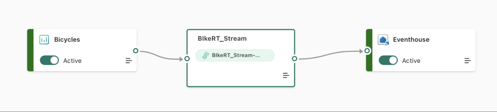
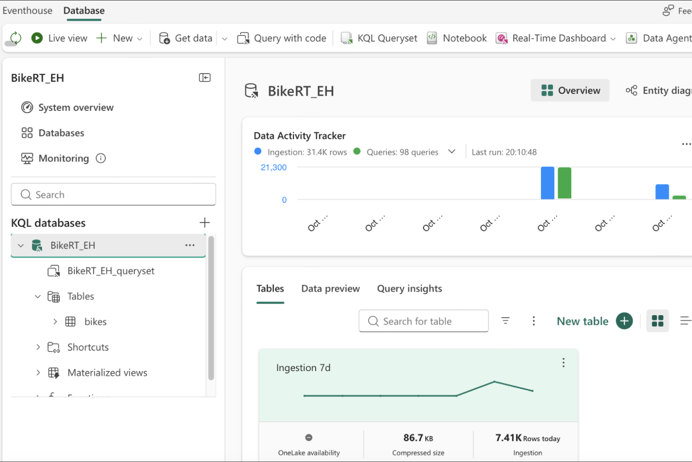
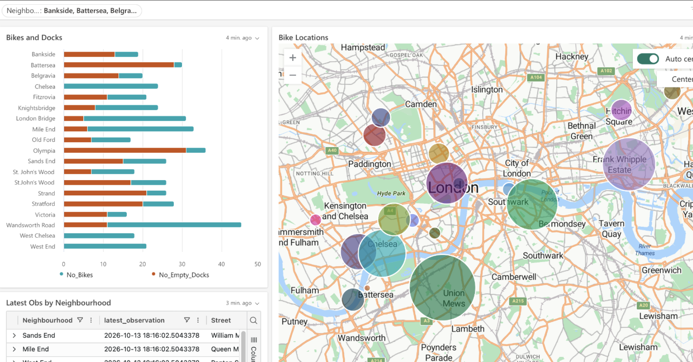
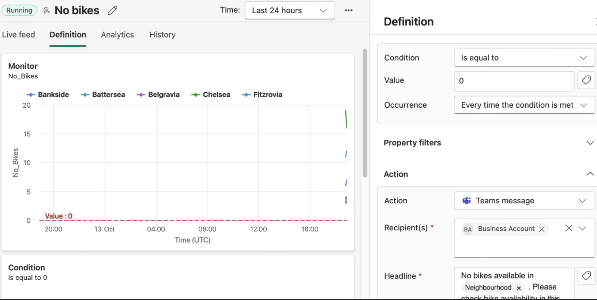

# London Bike Usage – Real-Time Data Engineering Project

## Overview

This project uses real-time data from London's commuter bicycle stations to monitor bike availability and empty docking spaces across different neighbourhoods.

Microsoft Fabric Eventstream ingests and processes incoming JSON events before routing them to a KQL database in Eventhouse. A real-time dashboard queries the stored data to visualise bike availability, station locations, and neighbourhood-level statistics.

Fabric Activator monitors bike availability and triggers a Microsoft Teams notification whenever a neighbourhood has no bikes available.

### Technologies Used
- Microsoft Fabric Eventstream
- Microsoft Fabric Eventhouse and KQL Database
- Kusto Query Language (KQL)
- Real-Time Dashboard
- Microsoft Fabric Activator
- Microsoft Teams

### Key Skills Demonstrated
- Real-time data ingestion and event streaming
- Low-code event processing and data routing
- Real-time data storage and querying using Eventhouse and KQL
- Interactive dashboard development and data visualisation
- Parameterised KQL queries and dashboard filtering
- Real-time data refresh and monitoring
- Event-driven alerting and automated notifications using Fabric Activator
- Integration of Microsoft Fabric services for real-time analytics

## Eventstream

Eventstream ingests the incoming JSON bike station data and routes it to a table named `bikes` in an Eventhouse KQL database.

Eventstream was chosen because it provides a low-code approach to real-time event ingestion and routing. Since the incoming data requires minimal transformation before storage, it offers a suitable solution without the overhead of a custom streaming pipeline.

## Eventhouse KQL Database

Eventhouse was selected as the data store because it is designed and optimised for analysing high-volume, time-based event data.

The `bikes` table stores the incoming station data and serves as the source for the dashboard's KQL queries, enabling real-time analysis of bike availability across London.

## Real-Time Dashboard

The dashboard provides an interactive view of bike availability across London's neighbourhoods.

**Visualisations and features:**

- **Stacked bar chart (top-left):** Compares the number of available bikes with the number of empty docking spaces across neighbourhoods.
- **Map (right):** Displays bicycle station locations, with bubble sizes representing the number of available bikes.
- **Data table (bottom-left):** Displays the latest available data for each neighbourhood.
- **Neighbourhood filter (top):** Filters the dashboard visuals to focus on selected neighbourhoods.
- **KQL queries:** Power the dashboard visuals, using a shared base query and parameterisation to support filtering.
- **Automatic refresh:** Refreshes the visuals every 30 seconds to keep the dashboard up to date.

## Fabric Activator

Fabric Activator monitors bike availability and triggers an alert when a neighbourhood has zero available bikes.

A rule evaluates the incoming data, and when the condition is met, a Teams message is sent identifying the affected neighbourhood. A dynamic parameter in the message headline inserts the neighbourhood name, making it easier to identify where bikes are unavailable.

This demonstrates how real-time event data can be used to drive automated alerts and operational responses.
